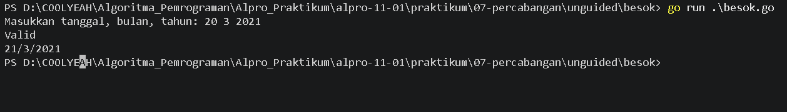
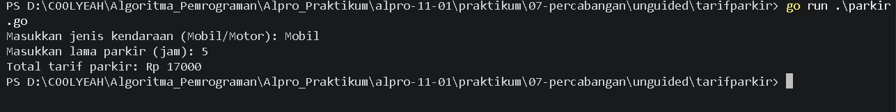

# <h1 align="center">Laporan Praktikum Modul 07 - Percabangan</h1>
<p align="center">[Alfaro Steve Christian Hadiwiyata] - [109092600022]</p>

## Dasar Teori

### A. Percabangan if
Percabangan merupakan salah satu struktur dasar dalam pemrograman yang digunakan untuk mengatur alur eksekusi program berdasarkan kondisi tertentu. Struktur ini memungkinkan program untuk mengambil keputusan dengan mengevaluasi suatu kondisi yang menghasilkan nilai boolean, yaitu true atau false. Dalam bahasa pemrograman Go, terdapat beberapa jenis percabangan, yaitu if, if-else, else-if, dan switch. Percabangan if digunakan untuk menjalankan perintah ketika suatu kondisi bernilai benar, sedangkan if-else digunakan untuk menentukan salah satu dari dua kemungkinan berdasarkan hasil evaluasi kondisi. Sementara itu, else-if memungkinkan program memeriksa beberapa kondisi secara berurutan, dan switch digunakan untuk memilih satu dari beberapa kemungkinan berdasarkan nilai atau kondisi yang sesuai. 

Dalam penerapannya, percabangan memanfaatkan operator perbandingan seperti ==, !=, >, <, >=, dan <=, serta operator logika seperti && (AND), || (OR), dan ! (NOT) untuk menggabungkan atau memodifikasi kondisi. Pada bahasa Go, struktur switch secara otomatis mengakhiri eksekusi suatu case, sehingga tidak memerlukan penggunaan break secara eksplisit. Dengan memahami konsep percabangan, programmer dapat membuat program yang mampu mengambil keputusan, melakukan validasi input, serta menghasilkan keluaran yang berbeda sesuai dengan kondisi yang diberikan.
<!-- Tambahkan poin A, B, C, ... atau sub-topik 1, 2, 3, ... sesuai kebutuhan modul -->

## Guided

### 1. kabisat.go

```go
package main

import "fmt"

func main() {
    var tahun int
    fmt.Scan(&tahun)

    if tahun % 4 == 0 || tahun % 400 == 0 && tahun % 100 != 0{
        fmt.Println("Ya")
} else{
    fmt.Println("Tidak")
}
}
```
#### Deskripsi
Program ini digunakan untuk menentukan suatu tahun itu merupakan tahun kabisat atau tidak. Pada program ini variabel tahun ini dijadikan ke dalam bentuk integer, setelah itu variabel tahun ini diinput secara manual melalui fmt.Scan. Setelah diinput program menentukan apakah angka pada tahun tersebut jika dihabis dibagi 4 atau habis dibagi 400 dan tidak habis dibagi 100 itu merupakan tahun kabisat lalu output-nya menjadi Ya, dan apabila kedua kondisi tersebut salah, maka output-nya akan menjadi Tidak.

### 2. segitiga.go

```go
package main

import "fmt"

func main() {
    var a, b, c int
    fmt.Scan(&a, &b, &c)

    if a <= 0 || b <= 0 || c <= 0 || a+b <= c || a+c <= b || c+b <= a{
        fmt.Println("Bukan segitiga")
    } else {
        if a == b && b == c{
            fmt.Println("Segitiga sama sisi")
        } else if a == b || b == c || a == c{
            fmt.Println("Segitiga sama kaki")
        } else {
            fmt.Println("Segitiga sembarang")
        }
    }
}

```
#### Deskripsi
Program ini digunakan untuk menentukan suatu bentuk dari segitiga melalui 3 inputan angka dan segitiga itu termasuk ke dalam bentuk sama kaki/sama sisi/sembarang. Pada program ini terdapat 3 inputan, yaitu a, b, dan c sebagai variabel integer. Setelah itu ketiga variabel integer ditentukan dalam kondisi percabangan if-else, di program ini terdapat 4 percabangan

### 3. kalkulator.go

```go
package main

import "fmt"

func main() {
   var a, b int
   var op string
   fmt.Scan(&a, &op, &b)

   switch op {
   case "+":
    fmt.Print(a + b)

   case "-":
    fmt.Print(a - b)

   case "*":
    fmt.Print(a * b)

   case "/":
    if b == 0{
        fmt.Println("Error: Ra iso nol mas pembagian ne")
    } else {
        fmt.Printf("%.2f\n", float64(a) / float64(b))
    }

    case "%":
    if b == 0{
        fmt.Println("Error: Ra iso nol mas pembagian ne")
    } else {
        fmt.Println(a % b)
   }
default:
    fmt.Println("Operator ne ora ada mas")
}
}
```
#### Deskripsi
Program ini digunakan untuk melakukan operasi aritmatika terhadap dua bilangan bulat. Program menerima input berupa dua bilangan dan satu operator, kemudian menggunakan percabangan switch untuk menentukan operasi yang akan dilakukan, yaitu penjumlahan, pengurangan, perkalian, pembagian, atau sisa hasil bagi. Program juga melakukan pemeriksaan terhadap pembagian dengan nol dan operator yang tidak valid agar dapat menampilkan pesan kesalahan yang sesuai.

### 4. ongkir.go

```go
package main

import (
    "fmt"
    "math"
)

func main() {
  var berat float64
  var zona int
  var layanan string

  fmt.Scan(&berat, &zona, &layanan)
  
  if berat > 30 {
    fmt.Println("Berat melebihi batas maksimum (30kg)")
    return
  }

  var tarifPerKg int

  switch zona {
  case 1:
    tarifPerKg = 10000

  case 2:
    tarifPerKg = 15000

  case 3:
    tarifPerKg = 25000

  default:
    fmt.Println("Zona tidak valid")
    return
  }

  beratBulat := int(math.Ceil(berat))
  total := beratBulat * tarifPerKg

  if layanan == "Express" {
    total = total + total / 2
  } else if layanan != "Reguler" {
    fmt.Println("Layanan tidak valid.")
    return
  }

  fmt.Println(beratBulat)
  fmt.Println(total)
}
```
#### Deskripsi
Program ini digunakan untuk menghitung biaya pengiriman paket berdasarkan berat paket, zona tujuan, dan jenis layanan yang dipilih. Program menggunakan fungsi math.Ceil() untuk membulatkan berat paket ke atas ke kilogram terdekat serta percabangan switch untuk menentukan tarif berdasarkan zona pengiriman. Selain itu, program memberikan biaya tambahan sebesar 50% untuk layanan Express, sedangkan layanan Reguler tidak dikenakan biaya tambahan. Program juga memeriksa apakah berat paket melebihi batas maksimum 30 kg dan apakah zona tujuan valid sebelum menghitung total biaya pengiriman.

<!-- Tambahkan blok file/kode lain sesuai jumlah file pada soal guided -->

## Unguided

### 1. besok.go

```go

package main

import "fmt"

func main() {
    var tanggal, bulan, tahun int
    var jumlahHari int

    fmt.Print("Masukkan tanggal, bulan, tahun: ")
    fmt.Scan(&tanggal, &bulan, &tahun)

    // Menentukan tahun kabisat
    kabisat := (tahun%4 == 0 && tahun%100 != 0) ||
        (tahun%400 == 0)

    // Menentukan jumlah hari dalam bulan
    switch bulan {
    case 1, 3, 5, 7, 8, 10, 12:
        jumlahHari = 31
    case 4, 6, 9, 11:
        jumlahHari = 30
    case 2:
        if kabisat {
            jumlahHari = 29
        } else {
            jumlahHari = 28
        }
    default:
        jumlahHari = 0
    }

    // Memeriksa validitas tanggal
    if tanggal < 1 || tanggal > jumlahHari {
        fmt.Println("Tanggal tidak valid")
    } else {
        fmt.Println("Valid")

        // Menentukan tanggal berikutnya
        tanggal++

        if tanggal > jumlahHari {
            tanggal = 1
            bulan++

            if bulan > 12 {
                bulan = 1
                tahun++
            }
        }

        fmt.Printf("%d/%d/%d\n", tanggal, bulan, tahun)
    }
}
```

##### Output
<!-- Path relatif dari readme.md ke folder unguided/[nama_soal]/output.png, contoh: -->



#### Deskripsi
Program ini digunakan untuk untuk memeriksa validitas suatu tanggal berdasarkan tanggal, bulan, dan tahun yang dimasukkan oleh pengguna, kemudian menentukan tanggal keesokan harinya. Program menggunakan percabangan if-else dan switch untuk memeriksa jumlah hari dalam setiap bulan serta menentukan apakah suatu tahun termasuk tahun kabisat atau bukan. Jika tanggal yang dimasukkan valid, program akan menampilkan keterangan valid beserta tanggal berikutnya. Program juga memperhitungkan pergantian bulan dan tahun, termasuk perubahan dari tanggal 31 Desember ke 1 Januari tahun berikutnya. Apabila tanggal tidak sesuai dengan ketentuan kalender, program akan menampilkan pesan bahwa tanggal tidak valid.

### 2. parkir.go

```go
package main
import "fmt"
func main() {
	
    var kendaraan string
    var jam, tarif, denda, total int

    fmt.Print("Masukkan jenis kendaraan (Mobil/Motor): ")
    fmt.Scan(&kendaraan)

    fmt.Print("Masukkan lama parkir (jam): ")
    fmt.Scan(&jam)

    if jam <= 0 {
        fmt.Println("Lama parkir tidak valid")
        return
    }

    if kendaraan == "Mobil" {
        tarif = 5000
        denda = 50000

        if jam > 1 {
            total = tarif + (jam-1)*3000
        } else {
            total = tarif
        }

    } else if kendaraan == "Motor" {
        tarif = 3000
        denda = 30000

        if jam > 1 {
            total = tarif + (jam-1)*2000
        } else {
            total = tarif
        }

    } else {
        fmt.Println("Jenis kendaraan tidak valid")
        return
    }

    if jam > 24 {
        total += denda
    }

    fmt.Println("Total tarif parkir: Rp", total)
}
```

##### Output
<!-- Path relatif dari readme.md ke folder unguided/[nama_soal]/output.png, contoh: -->



#### Deskripsi
Program ini digunakan untuk untuk menghitung biaya parkir berdasarkan jenis kendaraan dan durasi parkir. Program menerima input berupa jenis kendaraan, yaitu mobil atau motor, serta lama parkir dalam satuan jam. Perhitungan tarif dilakukan menggunakan percabangan if-else untuk membedakan jenis kendaraan dan menentukan biaya berdasarkan jam pertama serta jam berikutnya. Apabila lama parkir melebihi 24 jam, program akan memberikan denda tambahan sebesar Rp50.000 untuk mobil dan Rp30.000 untuk motor. Hasil akhir program berupa total biaya parkir yang harus dibayarkan.

## Kesimpulan
Berdasarkan praktikum Modul 07 tentang Percabangan menggunakan bahasa pemrograman Go, dapat disimpulkan bahwa percabangan merupakan salah satu konsep dasar pemrograman yang berfungsi untuk mengatur alur jalannya program berdasarkan kondisi tertentu. Dengan menggunakan percabangan, program dapat mengambil keputusan dan menjalankan perintah yang berbeda sesuai dengan nilai atau kondisi yang diberikan oleh pengguna.

Dalam praktikum ini, dipelajari penggunaan struktur if, if-else, else-if, dan switch untuk menyelesaikan berbagai permasalahan, seperti menentukan bilangan positif atau negatif, menentukan hari berdasarkan angka, menghitung tarif parkir, serta melakukan validasi tanggal dan perhitungan lainnya.

Melalui pengerjaan tugas praktikum, dapat dipahami bahwa pemilihan struktur percabangan yang tepat dapat membuat program menjadi lebih terstruktur, efektif, dan mudah dipahami. Selain itu, penggunaan kondisi yang tepat serta validasi input sangat penting untuk menghindari kesalahan proses dan menghasilkan keluaran yang sesuai dengan ketentuan program.

Dengan demikian, praktikum ini membantu meningkatkan pemahaman mengenai logika pengambilan keputusan dalam pemrograman serta menjadi dasar untuk mempelajari konsep pemrograman yang lebih kompleks.

## Referensi
1. The Go Authors. (n.d.). The Go Programming Language Specification. https://go.dev/ref/spec
2. The Go Authors. (n.d.). Effective Go. https://go.dev/doc/effective_go