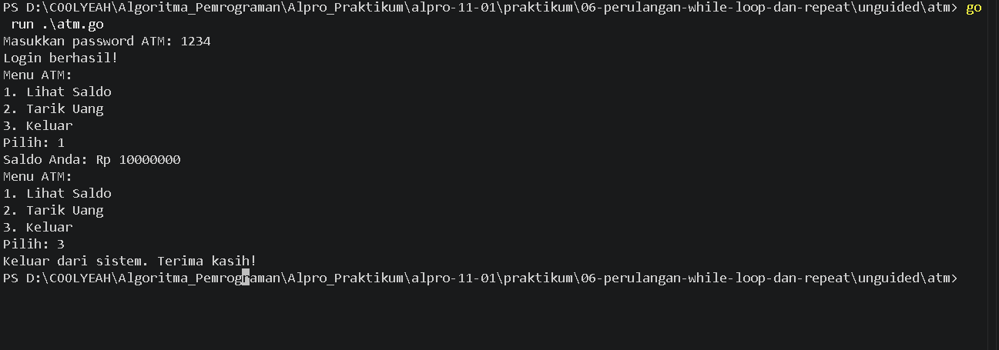
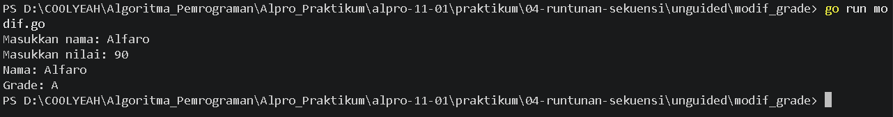

# <h1 align="center">Laporan Praktikum Modul 07 - Percabangan</h1>
<p align="center">[Alfaro Steve Christian Hadiwiyata] - [109092600022]</p>

## Dasar Teori

### A. Pengertian Perulangan (Looping)
Perulangan atau looping merupakan struktur kontrol dalam algoritma pemrograman yang digunakan untuk menjalankan sekumpulan instruksi secara berulang selama kondisi tertentu terpenuhi. Perulangan membantu menyederhanakan penulisan program karena instruksi yang sama tidak perlu ditulis berulang kali. Dalam bahasa pemrograman Go, perulangan menggunakan kata kunci for, yang dapat diterapkan dengan tiga komponen maupun hanya menggunakan kondisi.

### B. Perulangan While dalam bahasa Go
Perulangan while merupakan struktur perulangan yang menjalankan instruksi selama kondisi bernilai benar (true). Bahasa pemrograman Go tidak menyediakan kata kunci while secara langsung. Oleh karena itu, perulangan while diterapkan menggunakan for yang hanya berisi kondisi. Kondisi diperiksa sebelum instruksi di dalam perulangan dijalankan. Jika kondisi bernilai benar, instruksi akan dijalankan. Sebaliknya, jika kondisi bernilai salah, perulangan akan berhenti. Oleh karena itu, diperlukan perubahan nilai variabel atau kondisi lain di dalam perulangan agar program dapat mencapai kondisi berhenti dan tidak mengalami perulangan tanpa akhir.

### C. Komponen Perulangan While
Perulangan while memiliki beberapa komponen penting, yaitu kondisi, variabel pengendali, dan instruksi yang diulang. Kondisi berfungsi menentukan apakah perulangan dilanjutkan atau dihentikan. Variabel pengendali digunakan untuk menyimpan nilai yang memengaruhi kondisi perulangan, sedangkan instruksi yang diulang berisi proses yang akan dijalankan selama kondisi masih terpenuhi.

### D. Perulangan Repeat-Until
Perulangan repeat-until merupakan struktur perulangan yang menjalankan instruksi terlebih dahulu, kemudian memeriksa kondisi berhenti. Dengan demikian, instruksi di dalam perulangan dijalankan setidaknya satu kali, meskipun kondisi berhenti sebenarnya sudah terpenuhi sejak awal.

Bahasa pemrograman Go tidak menyediakan kata kunci repeat-until secara langsung. Perilaku tersebut dapat diterapkan menggunakan for dengan kondisi penghentian yang diperiksa di dalam blok perulangan.

### E. Penerapan Perulangan While
Perulangan while dapat digunakan untuk menyelesaikan berbagai permasalahan, seperti mencari bilangan yang memenuhi batas tertentu, menghitung jumlah karakter dalam sebuah kalimat, dan mengulang proses input sampai kondisi tertentu tercapai. Dalam penerapannya, program perlu menentukan kondisi awal, proses yang diulang, serta kondisi berhenti.

Sebagai contoh, untuk mencari bilangan bulat terkecil yang pangkat tiganya lebih besar dari suatu batas, program dapat memulai pencarian dari bilangan 1. Selama hasil pangkat tiga belum melebihi batas, nilai bilangan akan terus ditambah. Setelah kondisi terpenuhi, program menampilkan bilangan yang ditemukan.

<!-- Tambahkan poin A, B, C, ... atau sub-topik 1, 2, 3, ... sesuai kebutuhan modul -->

## Guided

### 1. kabisat.go

```go
package main

import "fmt"

func main() {
    var tahun int
    fmt.Scan(&tahun)

    if tahun % 4 == 0 || tahun % 400 == 0 && tahun % 100 != 0{
        fmt.Println("Ya")
} else{
    fmt.Println("Tidak")
}
}
```
#### Deskripsi
Program ini digunakan untuk menentukan suatu tahun itu merupakan tahun kabisat atau tidak. Pada program ini variabel tahun ini dijadikan ke dalam bentuk integer, setelah itu variabel tahun ini diinput secara manual melalui fmt.Scan. Setelah diinput program menentukan apakah angka pada tahun tersebut jika dihabis dibagi 4 atau habis dibagi 400 dan tidak habis dibagi 100 itu merupakan tahun kabisat lalu output-nya menjadi Ya, dan apabila kedua kondisi tersebut salah, maka output-nya akan menjadi Tidak.

### 2. segitiga.go

```go
package main

import "fmt"

func main() {
    var a, b, c int
    fmt.Scan(&a, &b, &c)

    if a <= 0 || b <= 0 || c <= 0 || a+b <= c || a+c <= b || c+b <= a{
        fmt.Println("Bukan segitiga")
    } else {
        if a == b && b == c{
            fmt.Println("Segitiga sama sisi")
        } else if a == b || b == c || a == c{
            fmt.Println("Segitiga sama kaki")
        } else {
            fmt.Println("Segitiga sembarang")
        }
    }
}

```
#### Deskripsi
Program ini digunakan untuk menentukan suatu bentuk dari segitiga melalui 3 inputan angka dan segitiga itu termasuk ke dalam bentuk sama kaki/sama sisi/sembarang. Pada program ini terdapat 3 inputan, yaitu a, b, dan c sebagai variabel integer. Setelah itu ketiga variabel integer ditentukan dalam kondisi percabangan if-else, di program ini terdapat 4 percabangan

### 3. kalkulator.go

```go
package main

import "fmt"

func main() {
   var a, b int
   var op string
   fmt.Scan(&a, &op, &b)

   switch op {
   case "+":
    fmt.Print(a + b)

   case "-":
    fmt.Print(a - b)

   case "*":
    fmt.Print(a * b)

   case "/":
    if b == 0{
        fmt.Println("Error: Ra iso nol mas pembagian ne")
    } else {
        fmt.Printf("%.2f\n", float64(a) / float64(b))
    }

    case "%":
    if b == 0{
        fmt.Println("Error: Ra iso nol mas pembagian ne")
    } else {
        fmt.Println(a % b)
   }
default:
    fmt.Println("Operator ne ora ada mas")
}
}
```
#### Deskripsi
Program ini digunakan untuk melakukan operasi aritmatika terhadap dua bilangan bulat. Program menerima input berupa dua bilangan dan satu operator, kemudian menggunakan percabangan switch untuk menentukan operasi yang akan dilakukan, yaitu penjumlahan, pengurangan, perkalian, pembagian, atau sisa hasil bagi. Program juga melakukan pemeriksaan terhadap pembagian dengan nol dan operator yang tidak valid agar dapat menampilkan pesan kesalahan yang sesuai.

### 4. ongkir.go

```go
package main

import (
    "fmt"
    "math"
)

func main() {
  var berat float64
  var zona int
  var layanan string

  fmt.Scan(&berat, &zona, &layanan)
  
  if berat > 30 {
    fmt.Println("Berat melebihi batas maksimum (30kg)")
    return
  }

  var tarifPerKg int

  switch zona {
  case 1:
    tarifPerKg = 10000

  case 2:
    tarifPerKg = 15000

  case 3:
    tarifPerKg = 25000

  default:
    fmt.Println("Zona tidak valid")
    return
  }

  beratBulat := int(math.Ceil(berat))
  total := beratBulat * tarifPerKg

  if layanan == "Express" {
    total = total + total / 2
  } else if layanan != "Reguler" {
    fmt.Println("Layanan tidak valid.")
    return
  }

  fmt.Println(beratBulat)
  fmt.Println(total)
}
```
#### Deskripsi
Program ini digunakan untuk menghitung biaya pengiriman paket berdasarkan berat paket, zona tujuan, dan jenis layanan yang dipilih. Program menggunakan fungsi math.Ceil() untuk membulatkan berat paket ke atas ke kilogram terdekat serta percabangan switch untuk menentukan tarif berdasarkan zona pengiriman. Selain itu, program memberikan biaya tambahan sebesar 50% untuk layanan Express, sedangkan layanan Reguler tidak dikenakan biaya tambahan. Program juga memeriksa apakah berat paket melebihi batas maksimum 30 kg dan apakah zona tujuan valid sebelum menghitung total biaya pengiriman.

<!-- Tambahkan blok file/kode lain sesuai jumlah file pada soal guided -->

## Unguided

### 1. besok.go

```go
package main
import "fmt"
func main(){

    const passwordBenar = "1234"

    saldo := 10000000
    percobaan := 0
    login := false

    for percobaan < 3 && !login {
        var password string

        fmt.Print("Masukkan password ATM: ")
        fmt.Scan(&password)

        if password == passwordBenar {
            login = true
            fmt.Println("Login berhasil!")
        } else {
            percobaan++
            fmt.Println("Password salah. Silakan coba lagi.")
        }
    }

    if !login {
        fmt.Println("ATM terblokir. Program selesai.")
        return
    }

    pilihan := 0

    for pilihan != 3 {
        fmt.Println("Menu ATM:")
        fmt.Println("1. Lihat Saldo")
        fmt.Println("2. Tarik Uang")
        fmt.Println("3. Keluar")
        fmt.Print("Pilih: ")
        fmt.Scan(&pilihan)

        if pilihan == 1 {
            fmt.Println("Saldo Anda: Rp", saldo)
        } else if pilihan == 2 {
            var penarikan int

            fmt.Print("Masukkan jumlah uang yang ingin ditarik: Rp ")
            fmt.Scan(&penarikan)

            if penarikan <= 0 {
                fmt.Println("Jumlah penarikan tidak valid.")
            } else if penarikan <= saldo {
                saldo -= penarikan
                fmt.Println("Anda berhasil menarik uang sebesar Rp", penarikan)
                fmt.Println("Saldo tersisa: Rp", saldo)
            } else {
                fmt.Println("Saldo tidak mencukupi.")
            }
        } else if pilihan == 3 {
            fmt.Println("Keluar dari sistem. Terima kasih!")
        } else {
            fmt.Println("Pilihan tidak valid.")
        }
    }
}
```

##### Output
<!-- Path relatif dari readme.md ke folder unguided/[nama_soal]/output.png, contoh: -->



#### Deskripsi
Program ini digunakan untuk memeriksa validitas suatu tanggal berdasarkan tanggal, bulan, dan tahun yang dimasukkan oleh pengguna, kemudian menentukan tanggal keesokan harinya. Program menggunakan percabangan if-else dan switch untuk memeriksa jumlah hari dalam setiap bulan serta menentukan apakah suatu tahun termasuk tahun kabisat atau bukan. Jika tanggal yang dimasukkan valid, program akan menampilkan keterangan valid beserta tanggal berikutnya. Program juga memperhitungkan pergantian bulan dan tahun, termasuk perubahan dari tanggal 31 Desember ke 1 Januari tahun berikutnya. Apabila tanggal tidak sesuai dengan ketentuan kalender, program akan menampilkan pesan bahwa tanggal tidak valid.

### 2. modif.go

```go
package main
import (
	"fmt"
	"bufio"
	"os"
)
func main() {
	var nama string
	var nilai float64
	var grade string

	scanner := bufio.NewScanner(os.Stdin)
	fmt.Print("Masukkan nama: ")
	scanner.Scan()
	nama = scanner.Text()
	fmt.Print("Masukkan nilai: ")
	fmt.Scan(&nilai)

	switch nilai {
		case nilai >= 90 && nilai <= 100:
			grade = "A"
		case nilai >= 80 && nilai < 90:
			grade = "B"
		case nilai >= 70 && nilai < 80:
			grade = "C"
		case nilai >= 60 && nilai < 70:
			grade = "D"
		default:
			grade = "E"
	}
	fmt.Printf("Nama: %s\n", nama)
	fmt.Printf("Grade: %s\n", grade)
}
```

##### Output
<!-- Path relatif dari readme.md ke folder unguided/[nama_soal]/output.png, contoh: -->



#### Deskripsi
Program ini digunakan untuk menentukan grade berdasarkan nama dan nilai yang dimasukkan pengguna. Program menggunakan 'bufio.Scanner' untuk membaca nama, 'fmt.Scan' untuk membaca nilai, dan 'switch' untuk menentukan grade A sampai E sesuai rentang nilai. Jika nilai di luar rentang 0–100, program menampilkan keterangan bahwa nilai tidak valid. Terakhir, program menampilkan nama dan grade pengguna.

## Kesimpulan
Berdasarkan praktikum Modul 07 tentang Percabangan, dapat disimpulkan bahwa perulangan while dalam Go diterapkan menggunakan for yang hanya berisi kondisi. Perulangan ini digunakan untuk menjalankan instruksi selama kondisi masih terpenuhi.

Program terkecil.go dan terbesar.go menerapkan perulangan untuk mencari bilangan yang memenuhi batas tertentu, sedangkan vokal.go menggunakannya untuk menghitung huruf vokal dalam kalimat. Program atm.go menerapkan perulangan untuk membatasi percobaan login dan menampilkan menu ATM hingga pengguna memilih keluar.

Praktikum ini memberikan pemahaman tentang penggunaan kondisi, perubahan variabel, dan penghentian perulangan, serta penerapannya bersama percabangan untuk menyelesaikan permasalahan menggunakan bahasa pemrograman Go.

## Referensi
1. The Go Authors. (n.d.). A Tour of Go — Basics. https://go.dev/tour/basics
2. The Go Authors. (n.d.). A Tour of Go — Flow Control Statements: for, if, else. https://go.dev/tour/flowcontrol
3. The Go Authors. (n.d.). Package fmt Documentation. https://pkg.go.dev/fmt
4. The Go Authors. (n.d.). Package bufio Documentation. https://pkg.go.dev/bufio
5. The Go Authors. (n.d.). Package strings Documentation. https://pkg.go.dev/strings