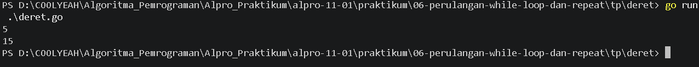
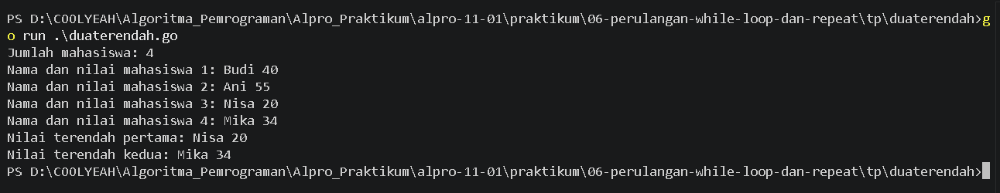
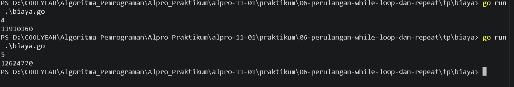

# <h1 align="center">Tugas Pendahuluan Modul [07] - [PERCABANGAN]</h1>
<p align="center">[Alfaro Steve Christian Hadiwiyata] - [109092600022]</p>

### 1. Penjelasan if, if-else, else if, dan switch

#### A. Perbedaan-perbedaanya

##### 1). If

if merupakan struktur percabangan yang digunakan untuk menjalankan suatu perintah apabila kondisi yang diberikan bernilai benar (true).

Jika kondisi bernilai salah (false), perintah di dalam blok if tidak akan dijalankan.

##### 2). If-else

if-else digunakan ketika terdapat dua kemungkinan kondisi. Jika kondisi pada if benar, blok if dijalankan. Jika salah, blok else akan dijalankan.

##### 3). Else-if

else if digunakan untuk memeriksa beberapa kondisi secara berurutan. Program akan menjalankan blok kode dari kondisi pertama yang bernilai benar.

##### 4). Switch

switch merupakan struktur percabangan yang digunakan untuk memilih satu dari beberapa kemungkinan berdasarkan nilai atau kondisi tertentu.

Switch biasanya lebih sederhana dan mudah dibaca dibandingkan penggunaan banyak if-else apabila terdapat banyak pilihan nilai.

#### B. Perbedaan Switch Go dan Java

Pada bahasa pemrograman Go, switch secara default tidak mengalami fallthrough, sehingga setelah suatu case dijalankan, program akan langsung keluar dari struktur switch tanpa melanjutkan ke case berikutnya. Jika ingin melanjutkan eksekusi ke case selanjutnya, Go harus menggunakan perintah fallthrough. Sementara itu, pada bahasa pemrograman Java, khususnya switch statement klasik, eksekusi dapat berlanjut ke case berikutnya apabila tidak menggunakan perintah break. Selain itu, Go mendukung penggunaan switch tanpa ekspresi, yaitu kondisi dapat dituliskan langsung pada setiap case menggunakan nilai boolean. Berbeda dengan Go, switch klasik pada Java menggunakan suatu ekspresi yang nilainya dibandingkan dengan setiap case.

### 2. bilangan.go

```go
package main
import "fmt"
func main(){
	var n int
	fmt.Print("Masukkan sebuah angka: ")
	fmt.Scan(&n)
	
	if n == 0 {
		fmt.Print("nol")
	} else {
		if n % 2 == 0 {
		fmt.Print("Genap, ")
	} else {
		fmt.Print("Ganjil, ")
	}

	if n > 0 {
		fmt.Print("Positif")
	} else {
		fmt.Print("Negatif")
	}
}
}	
```

##### Output
<!-- Path relatif dari readme.md ke folder unguided/[nama_soal]/output.png, contoh: -->


#### Deskripsi

Program bilangan.go merupakan program yang digunakan untuk menentukan jenis suatu bilangan bulat berdasarkan nilai yang dimasukkan oleh pengguna. Program ini menggunakan percabangan if-else untuk memeriksa apakah bilangan termasuk genap atau ganjil serta positif atau negatif. Jika bilangan yang dimasukkan bernilai 0, program akan menampilkan keterangan bahwa bilangan tersebut adalah nol. Proses penentuan bilangan genap atau ganjil menggunakan operator modulus (%), sedangkan penentuan bilangan positif atau negatif menggunakan operator perbandingan.

### 3. hari.go

```go
package main
import "fmt"
func main() {
    var n int
    fmt.Print("Jumlah mahasiswa: ")
    fmt.Scan(&n)

    if n < 2 {
        fmt.Println("Jumlah mahasiswa minimal 2.")
    } else {
        var nama1, nama2 string
        var nilai1, nilai2 int

        fmt.Print("Nama dan nilai mahasiswa 1: ")
        fmt.Scan(&nama1, &nilai1)

        fmt.Print("Nama dan nilai mahasiswa 2: ")
        fmt.Scan(&nama2, &nilai2)

        if nilai2 < nilai1 {
            nama1, nama2 = nama2, nama1
            nilai1, nilai2 = nilai2, nilai1
        }

        var i int = 3
        for i <= n {
            var nama string
            var nilai int

            fmt.Print("Nama dan nilai mahasiswa ", i, ": ")
            fmt.Scan(&nama, &nilai)

            if nilai < nilai1 {
                nama2 = nama1
                nilai2 = nilai1
                nama1 = nama
                nilai1 = nilai
            } else if nilai < nilai2 {
                nama2 = nama
                nilai2 = nilai
            }

            i++
        }

        fmt.Println("Nilai terendah pertama:", nama1, nilai1)
        fmt.Println("Nilai terendah kedua:", nama2, nilai2)
    }
}
```

##### Output
<!-- Path relatif dari readme.md ke folder unguided/[nama_soal]/output.png, contoh: -->


#### Deskripsi
Program hari.go merupakan program yang digunakan untuk menentukan nama hari berdasarkan nomor hari yang dimasukkan oleh pengguna, mulai dari 1 hingga 7. Program ini menggunakan struktur percabangan switch untuk mencocokkan nomor yang dimasukkan dengan nama hari yang sesuai. Khusus untuk hari Sabtu dan Minggu, program akan menambahkan keterangan akhir pekan. Jika nomor yang dimasukkan berada di luar rentang 1–7, program akan menampilkan pesan bahwa nomor hari tidak valid.

### 4. terbesar.go

```go

package main

import "fmt"

func main() {
    var n int
    fmt.Scan(&n)

    biaya := 10000000.0
    tahun := 1

    for tahun < n {
        biaya = biaya * 1.06
        tahun++
    }

    fmt.Printf("%.0f\n", biaya)
}
```

##### Output
<!-- Path relatif dari readme.md ke folder unguided/[nama_soal]/output.png, contoh: -->



#### Deskripsi
Program terbesar.go merupakan program yang digunakan untuk menentukan bilangan terbesar dari tiga bilangan bulat yang dimasukkan oleh pengguna. Program ini menggunakan percabangan if-else untuk membandingkan ketiga bilangan tersebut dan menentukan nilai yang paling besar. Proses perbandingan menggunakan operator >= dan operator logika && agar program dapat memeriksa beberapa kondisi sekaligus. Program ini dapat menangani bilangan positif, negatif, maupun bilangan yang memiliki nilai sama tanpa menggunakan perulangan atau fungsi bawaan max.

## Kesimpulan
Berdasarkan tugas praktikum yang telah dikerjakan, dapat disimpulkan bahwa materi percabangan merupakan salah satu konsep dasar dalam pemrograman yang digunakan untuk mengatur alur jalannya program berdasarkan kondisi tertentu. Melalui praktikum dan tugas pendahuluan ini, dapat dipahami bahwa bahasa pemrograman Golang menyediakan beberapa struktur percabangan, yaitu if, if-else, else if, dan switch.

Setiap struktur memiliki fungsi dan kegunaan yang berbeda. If digunakan untuk memeriksa satu kondisi, if-else untuk menentukan dua kemungkinan, else if untuk memeriksa beberapa kondisi, sedangkan switch digunakan untuk memilih tindakan berdasarkan beberapa kemungkinan nilai. Selain itu, penggunaan operator perbandingan seperti ==, >, >=, serta operator logika seperti && dan operator aritmatika modulus % sangat membantu dalam proses pengambilan keputusan di dalam program.

Berdasarkan keempat soal yang telah dikerjakan, dapat disimpulkan bahwa percabangan sangat penting dalam pemrograman karena memungkinkan program mengambil keputusan secara otomatis sesuai dengan input dan kondisi yang diberikan pengguna. Dengan memahami konsep percabangan, seorang programmer dapat membuat program yang lebih terstruktur, logis, efisien, dan mampu menangani berbagai kemungkinan kondisi.