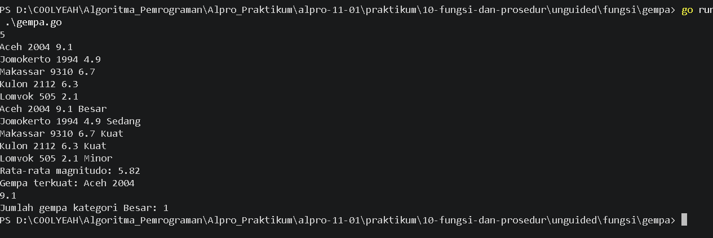
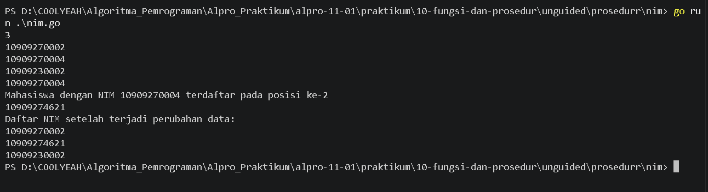

# <h1 align="center">Laporan Praktikum Modul 10 dan 11 - “FUNGSI DAN PROSEDUR”</h1>
<p align="center">[Rizky Fadlurrahman Ramadhan] - [109092630002]</p>

## Dasar Teori

### A. Fungsi
Fungsi adalah subprogram yang mengerjakan satu tugas dan mengembalikan sebuah nilai lewat `return`, sehingga hasilnya bisa langsung dipakai pada ekspresi. Di Go, fungsi ditulis dengan `func nama(parameter) tipeKembali`

### B. Prosedur
Prosedur adalah subprogram yang tidak mengembalikan nilai, ditulis sebagai `func` tanpa tipe kembali. Prosedur dipakai untuk melakukan aksi seperti membaca data, mengubah array, atau mencetak hasil. Kondisi sebelum dan sesudah prosedur dijalankan dinyatakan dengan *Initial State* (IS) dan *Final State* (FS)

### C. Parameter dan Pointer
Parameter *in* dikirim *by value*, sedangkan parameter *out* atau *in/out* dikirim sebagai pointer (`*tipe` saat deklarasi dan `&variabel` saat pemanggilan) agar perubahannya terlihat di program pemanggil

### D. Struct dan Array
`struct` mengelompokkan data yang berkaitan dalam satu tipe, sedangkan array menyimpan banyak data bertipe sama. Gabungan keduanya (array of struct) dipakai untuk menyimpan kumpulan data seperti daftar player atau gempa

## Guided

### 1. player.go (Fungsi)

```go
package main

import "fmt"

const NMAX int = 999

type player struct {
	nickname string
	score    int
}

type tabPlayer [NMAX]player

func rataRata(T tabPlayer, n int) float64 {
	total := 0
	for i := 0; i < n; i++ {
		total += T[i].score
	}
	return float64(total) / float64(n)
}

func idxTertinggi(T tabPlayer, n int) int {
	idx := 0
	for i := 1; i < n; i++ {
		if T[i].score > T[idx].score {
			idx = i
		}
	}
	return idx
}

func hitungDiAtas(T tabPlayer, n int, batas float64) int {
	count := 0
	for i := 0; i < n; i++ {
		if float64(T[i].score) > batas {
			count++
		}
	}
	return count
}

func main() {
	var T tabPlayer
	var n int
	fmt.Scan(&n)
	for i := 0; i < n; i++ {
		fmt.Scan(&T[i].nickname, &T[i].score)
	}

	avg := rataRata(T, n)
	best := idxTertinggi(T, n)
	di := hitungDiAtas(T, n, avg)

	fmt.Printf("Rata-rata skor: %.2f\n", avg)
	fmt.Printf("Player terbaik: %s (%d)\n", T[best].nickname, T[best].score)
	fmt.Printf("Jumlah player di atas rata-rata: %d\n", di)
}
```

#### Deskripsi
Program ini digunakan untuk mengolah data pemain, seperti menghitung rata-rata nilai, mencari pemain dengan nilai tertinggi, dan menghitung jumlah pemain yang memiliki nilai di atas rata-rata. Program menggunakan beberapa fungsi agar proses pengolahan data lebih terstruktur.

### 2. sapi.go (Prosedur)

```go
package main

import "fmt"

const NMAX int = 10000

type Arr [NMAX]int

func bacaData(T *Arr, n int) {
	for i := 0; i < n; i++ {
		fmt.Scan(&T[i])
	}
}

func geserKanan(T *Arr, n int) {
	terakhir := T[n-1]
	for i := n - 1; i > 0; i-- {
		T[i] = T[i-1]
	}
	T[0] = terakhir
}

func cetak(T Arr, n int) {
	for i := 0; i < n; i++ {
		if i > 0 {
			fmt.Print(" ")
		}
		fmt.Print(T[i])
	}
	fmt.Println()
}

func main() {
	var T Arr
	var n, k int
	fmt.Scan(&n, &k)
	bacaData(&T, n)

	for i := 0; i < k%n; i++ {
		geserKanan(&T, n)
	}
	cetak(T, n)
}
```

#### Deskripsi
Program ini digunakan untuk mengolah data jumlah sapi menggunakan array. Program dapat membaca data, menggeser posisi data ke kanan berdasarkan jumlah pergeseran yang ditentukan, dan menampilkan hasilnya. Proses tersebut dilakukan menggunakan prosedur.

## Unguided

### 1. gempa.go (Fungsi)

```go
package main

import "fmt"

type Gempa struct {
	nama      string
	tahun     int
	magnitudo float64
}

func kategori(m float64) string {
	if m < 4.0 {
		return "Minor"
	} else if m < 6.0 {
		return "Sedang"
	} else if m < 7.0 {
		return "Kuat"
	}

	return "Besar"
}

func rataMagnitudo(T []Gempa, n int) float64 {
	total := 0.0

	for i := 0; i < n; i++ {
		total += T[i].magnitudo
	}

	return total / float64(n)
}

func idxTerkuat(T []Gempa, n int) int {
	idx := 0

	for i := 1; i < n; i++ {
		if T[i].magnitudo > T[idx].magnitudo {
			idx = i
		}
	}

	return idx
}

func hitungKategori(T []Gempa, n int, k string) int {
	jumlah := 0

	for i := 0; i < n; i++ {
		if kategori(T[i].magnitudo) == k {
			jumlah++
		}
	}

	return jumlah
}

func main() {
	var n int
	fmt.Scan(&n)

	T := make([]Gempa, n)

	for i := 0; i < n; i++ {
		fmt.Scan(&T[i].nama, &T[i].tahun, &T[i].magnitudo)
	}

	for i := 0; i < n; i++ {
		fmt.Printf("%s %d %.1f %s\n",
			T[i].nama, T[i].tahun,
			T[i].magnitudo, kategori(T[i].magnitudo))
	}

	avg := rataMagnitudo(T, n)
	idx := idxTerkuat(T, n)
	jumlah := hitungKategori(T, n, "Besar")

	fmt.Printf("Rata-rata magnitudo: %.2f\n", avg)
	fmt.Printf("Gempa terkuat: %s %d\n",
		T[idx].nama, T[idx].tahun)
	fmt.Printf("%.1f\n", T[idx].magnitudo)
	fmt.Printf("Jumlah gempa kategori Besar: %d\n", jumlah)
}
```

##### Output


#### Deskripsi
Program ini digunakan untuk mengolah data gempa berdasarkan magnitudo. Program dapat menentukan kategori gempa, menghitung rata-rata magnitudo, mencari gempa dengan magnitudo terbesar, serta menghitung jumlah gempa berdasarkan kategorinya menggunakan fungsi.

### 2. nim.go (Prosedur)

```go
package main

import "fmt"

const NMAX int = 2002

type tabNIM [NMAX]int64

func cariNIM(T tabNIM, n int, x int64, idx *int) {
	*idx = -1
	for i := 0; i < n; i++ {
		if T[i] == x && *idx == -1 {
			*idx = i
		}
	}
}

func ubahNIM(T *tabNIM, idx int, baru int64) {
	T[idx] = baru
}

func cetak(T tabNIM, n int) {
	for i := 0; i < n; i++ {
		fmt.Println(T[i])
	}
}

func main() {
	var T tabNIM
	var n, idx int
	var x, baru int64

	fmt.Scan(&n)
	for i := 0; i < n; i++ {
		fmt.Scan(&T[i])
	}

	fmt.Scan(&x)
	cariNIM(T, n, x, &idx)

	if idx == -1 {
		fmt.Println("NIM tidak ditemukan dalam sistem")
	} else {
		fmt.Printf("Mahasiswa dengan NIM %d terdaftar pada posisi ke-%d\n", x, idx+1)
		fmt.Scan(&baru)
		ubahNIM(&T, idx, baru)
		fmt.Println("Daftar NIM setelah terjadi perubahan data:")
		cetak(T, n)
	}
}
```

##### Output


#### Deskripsi
Program ini digunakan untuk mengolah data NIM mahasiswa dalam array. Program dapat mencari NIM tertentu, mengubah NIM berdasarkan posisi yang ditentukan, dan menampilkan seluruh data NIM menggunakan prosedur.

## Kesimpulan
Berdasarkan praktikum modul fungsi dan prosedur, dapat disimpulkan bahwa fungsi dan prosedur membantu membagi program menjadi bagian-bagian yang lebih terstruktur sesuai tugasnya. Fungsi digunakan untuk mengolah data dan mengembalikan nilai, sedangkan prosedur digunakan untuk menjalankan proses tertentu tanpa mengembalikan nilai secara langsung. Dengan memahami keduanya, praktikan dapat membuat program yang lebih efektif, mudah dipahami, serta mempermudah proses pengolahan dan pengelolaan data.
## Referensi
1. The Go Authors. (2024). *The Go Programming Language Specification*. https://go.dev/ref/spec
2. Donovan, A. A., & Kernighan, B. W. (2015). *The Go Programming Language*. New York: Addison-Wesley
3. Laboratorium Praktikum Informatika. (2026). *Modul 10: Fungsi dan Modul 11: Prosedur - Algoritma dan Pemrograman 2*. Bandung: Fakultas Informatika, Universitas Telkom